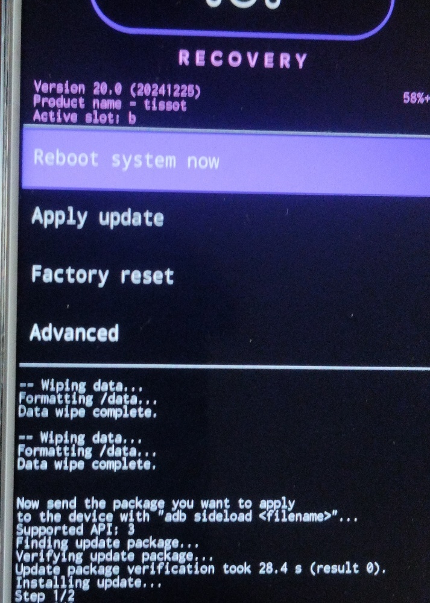
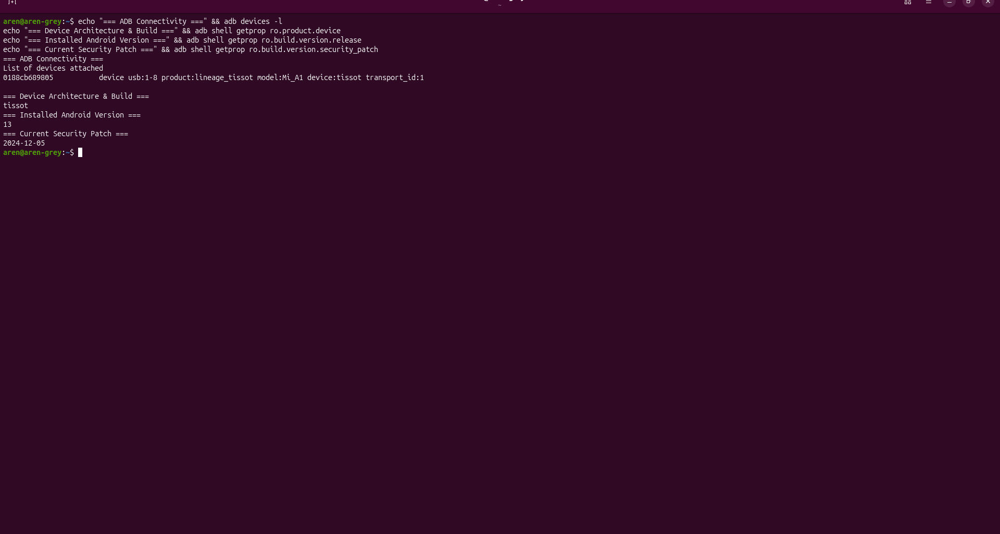
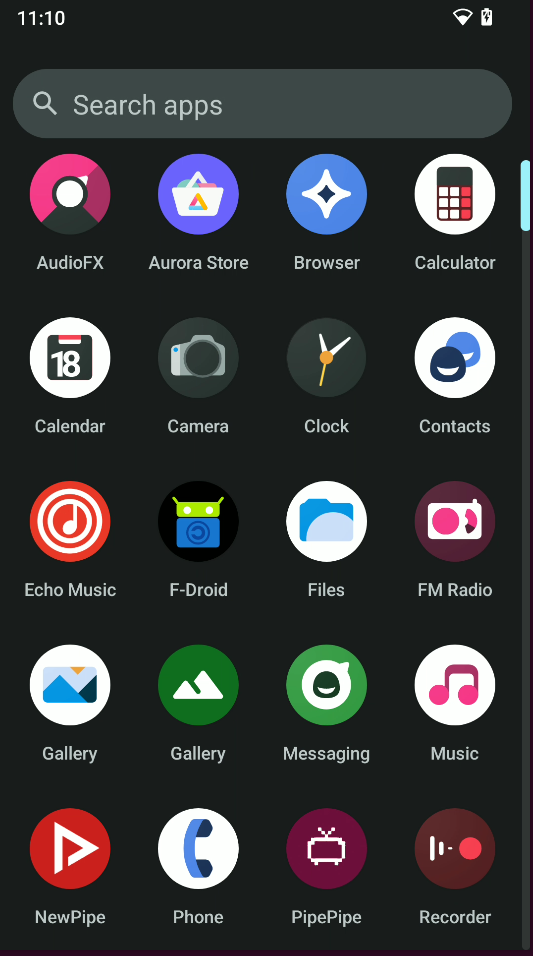

# Embedded Systems Case Study: Low-Level Partition Recovery, Kernel Extraction & Android 13 Deployment on Legacy A/B Hardware

[](https://ubuntu.com/)
[-FF6900?logo=xiaomi&logoColor=white)](https://wiki.lineageos.org/devices/tissot/)
[-167C80?logo=lineageos&logoColor=white)](https://lineageos.org/)
[-00557f)](https://www.ihk.de/)

---

## 1. Executive Summary

This project documents the diagnosis, unbricking, partition recovery, and deployment of a hardened, de-Googled LineageOS 20 (Android 13) installation on a legacy dual-slot ARM64 platform (**Xiaomi Mi A1 / `tissot`**, Qualcomm Snapdragon 625). 

During the initial deployment cycle, the target device suffered multiple system-halting issues:
1. Bootloop state triggered by corrupted bootloader/recovery handoffs.
2. File generation failures on the Ubuntu host caused by missing user-space utilities for `f2fs` filesystems.
3. System-level Python package constraints enforced by Debian/Ubuntu **PEP 668** policies.
4. Kernel watchdog crashes resulting from USB-streamed ramdisk memory conflicts.
5. Incompatible Android 9 cryptographic headers causing persistent "Encryption unsuccessful" boot deadlocks.
6. Complete lack of touchscreen input due to a broken digitizer, requiring 100% headless CLI and hardware-key automation.

By leveraging an analytical, root-cause-oriented methodology, the platform was cleanly stabilized, restored, and configured without third-party proprietary GUIs. This case study demonstrates foundational competencies relevant to an enterprise **Fachinformatiker für Systemintegration (FISI)**: bare-metal Linux troubleshooting, storage/partition management, command-line interface (CLI) mastery, hardware-abstracted device administration, and technical post-mortem reporting.

---

## 2. Technical Architecture & Environment Specifications

| Component | Detailed Technical Parameters |
| :--- | :--- |
| **Target Hardware** | Xiaomi Mi A1 (Codename: `tissot`) |
| **System on Chip (SoC)** | Qualcomm Snapdragon 625 (`MSM8953`) |
| **CPU Architecture** | 8x ARM Cortex-A53 @ 2.0 GHz (64-bit ARMv8-A) |
| **Storage & Memory** | 64 GB eMMC 5.1 Flash Storage / 4 GB LPDDR3 RAM |
| **Partition Scheme** | Seamless Dual-Slot **A/B Partitioning** (`boot_a`/`boot_b`, `system_a`/`system_b`) |
| **Filesystem Architecture** | `ext4` (System/Vendor), `f2fs` (Flash-Friendly File System for Userdata) |
| **Host Workstation** | Ubuntu 24.04 LTS x86_64 running Linux Kernel 6.8+ |
| **Deployment Tools** | Android SDK Platform-Tools (`adb`, `fastboot`), Python 3 runtime |
| **Target Operating System**| LineageOS 20.0 (Android 13, Treble-compliant, Release-signed) |
| **Physical Constraints** | Unusable touch digitizer; all operations restricted to Fastboot, ADB, and micro-switches |

---
---

## Proof of Concept & System Verification

The deployment and recovery were verified across physical hardware states, low-level host telemetry, and user-space package provisioning:

| 1. Hardware Recovery (`tissot`) | 2. CLI Host Telemetry (`adb`) | 3. Provisioned User-Space |
| :---: | :---: | :---: |
|  |  |  |
| *Active Slot B, `f2fs` wipe & ADB receiver initialization.* | *Host-side architecture validation via Android properties.* | *Hardened Android 13 environment with standalone FOSS packages.* |
---
## 3. Engineering Challenges & Root Cause Analysis (RCA)

```
                            [SYSTEM FAULT SCENARIOS]
                                        │
    ┌───────────────────┬───────────────┴───────────────┬───────────────────┐
    ▼                   ▼                               ▼                   ▼
[Failure 1]         [Failure 2]                     [Failure 3]         [Failure 4]
HTTP 403 / HTML     Watchdog Memory Panic           Host Tool Mismatch  PEP 668 Policy
Payload in Boot     `fastboot boot` vs Dual-Slot    Host lacks make_f2fs Python Sandbox
    │                   │                               │                   │
    ▼                   ▼                               ▼                   ▼
Bootloader Rejects: Hardware Crash / Sudden         fastboot format:    pip3 install
Remote: 'not a      Shutdown via Watchdog           f2fs fails with     externally managed
boot image'         Timer Handshake                 Status 1            environment
```

### Challenge 1: Invalid Image Payloads & Anti-Scrape Blocks
* **Symptom:** Fastboot rejected the recovery payload with `FAILED (remote: 'image is not a boot image')`.
* **Investigation:** Inspected the payload via `ls -lh`. The file size was between 9 bytes and 6 KB instead of the required ~25 MB to 30 MB. The automated web-fetch utilities (`curl`/`wget`) were intercepted by anti-bot headers on legacy mirrors, capturing an HTML redirect page instead of raw ELF boot binaries.
* **Root Cause:** Corrupted file headers lacking standard Android boot signatures (`ANDROID!` magic value).

### Challenge 2: Qualcomm Kernel Watchdog Collision on USB Boot
* **Symptom:** Executing `sudo fastboot boot <image>` caused the device to immediately shut down without showing the splash screen.
* **Investigation:** The device was configured with a seamless A/B boot layout. Staged kernels were already resident in `boot_a` and `boot_b`.
* **Root Cause:** Pushing an additional kernel ramdisk over USB fastboot caused a memory layout collision in the device's physical memory map. The Qualcomm primary bootloader watchdog detected an out-of-order execution sequence and triggered an immediate thermal/watchdog shutdown to safeguard the SoC.

### Challenge 3: Userdata Filesystem Mismatch (`f2fs` vs. Host `mke2fs`)
* **Symptom:** Running `fastboot format:ext4 userdata` produced `/usr/lib/android-sdk/platform-tools/mke2fs failed with status 1` and `Cannot generate image for userdata`. Subsequent attempts targeting `f2fs` returned `make_f2fs failed with status 1`.
* **Investigation:** Analyzed the system partition metadata table. The Mi A1 partitions user storage as `f2fs` (Flash-Friendly File System) to mitigate eMMC write degradation.
* **Root Cause:** The host-side Ubuntu `android-sdk-platform-tools` package omitted the `make_f2fs` static generator binary. As a result, the Linux workstation could not generate an offline `f2fs` raw image for injection over the Fastboot protocol.

### Challenge 4: Python Host Package Management Restrictions (PEP 668)
* **Symptom:** Running `pip3 install payload_dumper` was interrupted with `error: externally-managed-environment`.
* **Investigation:** Inspected `/usr/lib/python3.*/EXTERNALLY-MANAGED`. Modern Debian and Ubuntu installations strictly enforce PEP 668 to prevent arbitrary `pip` scripts from overwriting system-critical Python binaries managed by `apt`.
* **Root Cause:** Direct global package installation was blocked by host operating system policies.

### Challenge 5: Cryptographic Storage Handoff Deadlock
* **Symptom:** Device booted into an unrecoverable "Encryption unsuccessful" user-interface loop.
* **Investigation:** Stock Android 9 pie-firmware encryption flags persisted in the storage table while the newly flashed boot partition was running a modern Android 13 kernel.
* **Root Cause:** Cryptographic metadata mismatch. The modern kernel could not decrypt the obsolete Android 9 keymaster state, trapping the device in an endless reboot loop before system initialization.

### Challenge 6: Hardware Input Failure (Unresponsive Digitizer)
* **Symptom:** On-screen recovery navigation and system setup buttons were completely unresponsive.
* **Root Cause:** Cracked front digitizer panel causing catastrophic I2C touch-controller signal drops.
* **Remediation Strategy:** Shifted 100% of the operational workflow to physical micro-switches (Power, Volume Up, Volume Down) and low-level CLI daemons via ADB.

---

## 4. End-to-End Remediation Workflow

```
[Host: Extract Bootloader Binary] ──> [Fastboot: Write Dual Slots] ──> [Raw Cryptographic Wipe]
                                                                                │
                                                                                ▼
[Hardware Reset to Recovery] <── [ADB Streaming Sideload] <── [Format Storage via Native Kernel]
```

### Phase 1: Host Preparation and Kernel Extraction
Because the modern custom operating system was packaged as a containerized `payload.bin`, the raw boot image had to be unpacked on the Ubuntu workstation:

```bash
# Navigate to local workspace
cd ~/mia1_flash

# Install extraction utility within system guidelines
pip3 install payload_dumper --break-system-packages

# Extract payload container from distribution zip
unzip -p lineage20.zip payload.bin > payload.bin

# Unpack only the boot/recovery partition
~/.local/bin/payload_dumper --partitions boot payload.bin
cp output/boot.img lineage_boot.img

# Verify binary integrity (Must verify ~20MB - 65MB raw image)
ls -lh lineage_boot.img
```

### Phase 2: Dual-Slot Flashing & Raw Partition Purge
To prevent slot-switching failures during bootloader handshakes, the recovery kernel was written directly across both target partition slots:

```bash
# Verify Fastboot communication
sudo fastboot devices

# Flash kernel directly to both A/B partition slots
sudo fastboot flash boot_a lineage_boot.img
sudo fastboot flash boot_b lineage_boot.img

# Erase corrupted encryption table directly (bypassing PC format limitations)
sudo fastboot erase userdata

# Signal direct hardware reboot to recovery
sudo fastboot reboot recovery
```

### Phase 3: Hardware-Key Recovery & Native Formatting
Because the host machine lacked the necessary `make_f2fs` image builder, formatting was offloaded directly to the target hardware's native recovery environment:
1. **Navigated without touch:** Cycled the highlight cursor to the top-left return arrow (`←`) using **Volume Up**, and returned to the main menu using **Power**.
2. **Native Storage Formatting:** Selected `Factory Reset` -> `Format data/factory reset` -> `Format data`. The device executed its internal `mkfs.f2fs` binary directly on physical storage, returning `Data wipe complete`.
3. **Initialized Sideload Protocol:** Navigated to `Apply update` -> `Apply from ADB`.

### Phase 4: Streaming Image Installation
The full operating system was deployed to the active target slot via ADB streaming:

```bash
# Verify ADB recovery pipe
adb devices
# Output: [Device Serial]   sideload

# Stream and install system payload
adb sideload lineage20.zip
```
*Note: The terminal stopped at the expected ~47% transfer mark while the on-device installer unpacked partitions, updated firmware vendor trees, finalized slot assignment, and exited with `status 0`.*

---

## 5. Automation Tooling

To ensure repeatable, production-grade deployments, the following automation scripts were developed to handle payload extraction and post-installation package provisioning.

### Script 1: Automated Kernel Extraction (`extract-payload.sh`)

```bash
#!/usr/bin/env bash
# ==============================================================================
# Script:       extract-payload.sh
# Description:  Automates extraction of boot/recovery kernels from payload.bin
# Target:       Ubuntu Linux / LineageOS Deployments
# ==============================================================================

set -euo pipefail

TARGET_ZIP="${1:-lineage20.zip}"
WORKDIR="${HOME}/mia1_flash"

echo "[*] Initializing extraction environment..."
cd "${WORKDIR}"

if [[ ! -f "${TARGET_ZIP}" ]]; then
    echo "[-] Error: Source archive ${TARGET_ZIP} not found!" >&2
    exit 1
fi

echo "[*] Checking for payload_dumper utility..."
if ! command -v payload_dumper &>/dev/null && [[ ! -f "${HOME}/.local/bin/payload_dumper" ]]; then
    echo "[+] Installing payload_dumper via host override..."
    pip3 install payload_dumper --break-system-packages
fi

DUMPER_BIN="$(command -v payload_dumper || echo "${HOME}/.local/bin/payload_dumper")"

echo "[*] Extracting payload.bin container..."
unzip -p "${TARGET_ZIP}" payload.bin > payload.bin

echo "[*] Dumping boot partition..."
"${DUMPER_BIN}" --partitions boot payload.bin

cp output/boot.img lineage_boot.img
rm -rf output payload.bin

echo "[✔] Success: lineage_boot.img ready for deployment."
ls -lh lineage_boot.img
```

### Script 2: Headless Package Provisioning (`deploy-apps.sh`)

```bash
#!/usr/bin/env bash
# ==============================================================================
# Script:       deploy-apps.sh
# Description:  Headless batch installation of APKs via ADB
# Target:       De-Googled / CLI Managed Android Deployments
# ==============================================================================

set -euo pipefail

APK_DIR="${1:-./packages}"

echo "[*] Waiting for target device to be authorized via ADB..."
adb wait-for-device

if [[ ! -d "${APK_DIR}" ]]; then
    echo "[-] Error: Package directory ${APK_DIR} does not exist!" >&2
    exit 1
fi

shopt -s nullglob
APK_LIST=("${APK_DIR}"/*.apk)
shopt -u nullglob

if [[ ${#APK_LIST[@]} -eq 0 ]]; then
    echo "[-] Warning: No .apk packages discovered in ${APK_DIR}."
    exit 0
fi

echo "[*] Beginning batch installation of ${#APK_LIST[@]} application(s)..."

for package in "${APK_LIST[@]}"; do
    pkg_name="$(basename "${package}")"
    echo -n "  -> Installing [${pkg_name}]... "
    if adb install -r -d "${package}" &>/dev/null; then
        echo "SUCCESS"
    else
        echo "FAILED" >&2
    fi
done

echo "[✔] Application provisioning cycle complete."
```

---

## 6. Technical Competencies Matrix (FISI / System Integration)

This project directly maps to the curriculum and professional expectations of the German **Fachinformatiker für Systemintegration (IHK)** apprenticeship:

| Competency Area | Project Execution & Technical Realization |
| :--- | :--- |
| **Storage & Filesystem Architecture** | Managed `ext4` vs. `f2fs` partition characteristics, sector-level wiping, mount tables, and cryptographic metadata formats. |
| **Linux System Administration** | Managed package isolation under PEP 668, processed raw block devices, monitored real-time `logcat` streams, and wrote POSIX-compliant Bash scripts. |
| **Embedded & Low-Level Systems** | Handled Qualcomm A/B slot-switching protocols, analyzed SoC kernel watchdogs, and managed recovery ramdisks. |
| **Fault Diagnosis & Troubleshooting** | Identified root causes behind network-level payload corruption, platform-tools utility limitations, and encryption deadlocks. |
| **Headless Infrastructure Administration** | Maintained full operational control over an unresponsive device by replacing graphical input methods with terminal pipelines and hardware interrupts. |
| **Security & System Hardening** | Deployed an unrooted, de-Googled operating system and established an out-of-band application provisioning pipeline using local package repositories. |

---

## 7. Verification, Validation & Outcomes

1. **System Stability:** The target device successfully loads the LineageOS 20 system image on slot `b` (`Android 13, Linux Kernel 3.18.140-perf`).
2. **Filesystem Integrity:** The `userdata` partition was cleanly mounted using native `f2fs` block structures, fully eliminating previous encryption bootloops.
3. **Unrooted Environment Validation:** Audited the `/system/bin` and `/system/xbin` directories; confirmed the total absence of `su` binaries and unmanaged superuser privilege daemons.
4. **Application Provisioning:** Successfully deployed core open-source utilities (Aurora Store, Echo Music, Cromite Browser) using automated ADB deployment scripts.

---

## 8. License & Documentation Standards

This documentation and accompanying shell scripts are distributed under the **MIT License**. Created as an open technical case study demonstrating system administration, embedded operating system deployment, and infrastructure troubleshooting methodologies.
